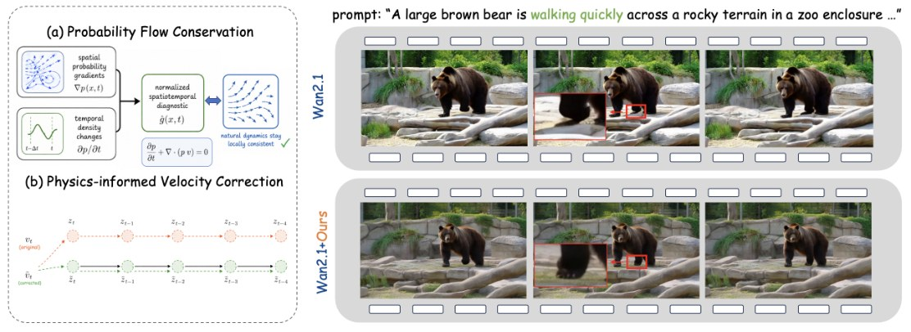
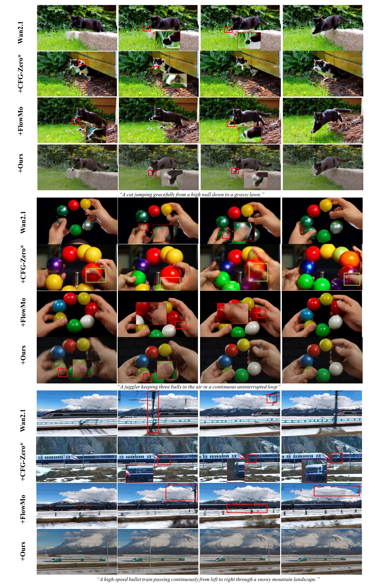

# PhysFlow

**Physics-Intrinsic Velocity Regularization for Motion-Intensive Video Generation**

<p align="center">
  
</p>

PhysFlow is a training-free plug-in for flow-matching text-to-video models. At each sampling step it diagnoses frame-to-frame inconsistency in the predicted velocity and applies a closed-form correction, reducing object fragmentation, deformation and flickering in motion-intensive videos. Model weights stay frozen and no extra forward passes are needed. This repository provides the implementation for **Wan2.1-T2V-1.3B** and the MotionStress-100 prompts.

## Installation

```bash
conda env create -f environment.yml
conda activate physflow
# FlashAttention (recommended; about 2x faster). Prebuilt wheel for torch 2.7 / CUDA 12 / Python 3.12:
pip install https://github.com/Dao-AILab/flash-attention/releases/download/v2.8.3/flash_attn-2.8.3+cu12torch2.7cxx11abiTRUE-cp312-cp312-linux_x86_64.whl
```

This is the environment used for the paper (Python 3.12, PyTorch 2.7.1 + CUDA 12.6, flash-attn 2.8.3, transformers 4.40.2, diffusers 0.37.0, NVIDIA 1800).

Download the Wan2.1 checkpoint into the repository root:

```bash
python -c "from huggingface_hub import snapshot_download; snapshot_download('Wan-AI/Wan2.1-T2V-1.3B', local_dir='Wan2.1-T2V-1.3B')"
```

## Quick start

Generate one video with PhysFlow and one without it, from the same seed:

```bash
CUDA_VISIBLE_DEVICES=0 python generate.py \
  --task t2v-1.3B --ckpt_dir ./Wan2.1-T2V-1.3B \
  --size '832*480' --frame_num 41 \
  --sample_solver unipc --sample_steps 50 \
  --sample_guide_scale 5.0 --sample_shift 5.0 \
  --prompt 'A high-speed bullet train passing continuously from left to right through a snowy mountain landscape.' \
  --num_videos_per_prompt 1 --base_seed 42 \
  --use_physics True --compare_physics True \
  --nsg_alpha 5.0 --straight_beta 1.0 \
  --physics_start_ratio 0 --physics_end_ratio 0.7 \
  --safe_threshold 20.0 --physics_decay 1 \
  --output_dir outputs/quickstart
```

The two videos are written to `outputs/quickstart/nsg5.0_..._seed42/` (PhysFlow) and `outputs/quickstart/no_physics_..._seed42/` (baseline). Set `--compare_physics False` to generate only the mode chosen by `--use_physics`.

> **Note.** Outputs vary slightly with the PyTorch / flash-attn version and GPU. For a few seeds the baseline can even land on a visibly different video, while PhysFlow outputs stay consistent across environments.

## Batch generation on MotionStress-100

```bash
GPU_IDS=0 DESIRED_GPUS=1 BASE_SEED=42 bash Infer.sh
```

This generates three videos per prompt in `prompts/prompts.txt`, with and without PhysFlow (seeds 42, 43, 44), into `videos10/`. Use several GPUs with, for example, `GPU_IDS="0 1 2 3" DESIRED_GPUS=4`. Without `BASE_SEED`, every video draws its own random seed. `Infer.sh` uses 10 sampling steps; edit `--sample_steps` in it for 50.

## Evaluation (optional)

MotionStress question answering with a VLM judge (download `Qwen/Qwen2.5-VL-7B-Instruct` first):

```bash
bash evaluate.sh --video_folder <video dir> --prompts_file prompts/prompts.txt \
  --model_path models/Qwen2.5-VL-7B-Instruct --model_type qwen --output_dir outputs/qa
```

CLIP / DINO frame consistency:

```bash
bash evaluate_metrics.sh --video_dirs <baseline dir> <physflow dir> --prompts_file prompts/prompts.txt --output_dir outputs/metrics
```

## Examples

<p align="center">
  
</p>

## License

The Wan2.1 code keeps its original copyright notices. The Wan2.1 model license is in [licenses/Wan2.1-model-LICENSE.txt](licenses/Wan2.1-model-LICENSE.txt).
"# PhysFlow-repo" 
